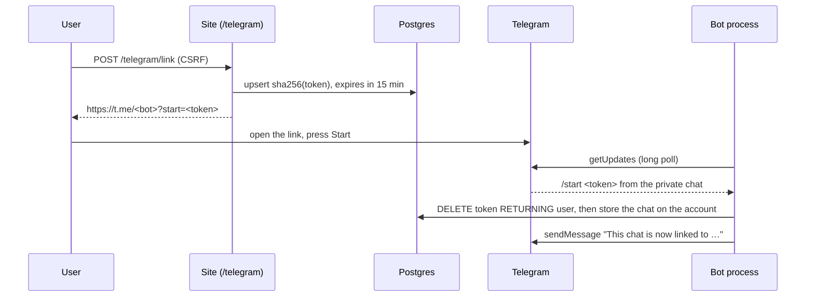

# Telegram

Matches are sent to a Telegram chat linked to the account. This page describes the bot, how a chat is linked, and how the bot token is kept secret. Sending matches comes with notifications, the last part of stage 7.

## Setting up a bot

1. Message [@BotFather](https://t.me/BotFather), send `/newbot`, and choose a name and a username ending in `bot`.
2. Put its token and username into `.env`. Never commit them: only `.env.example` is in the repository, with both empty.

   ```sh
   TELEGRAM_BOT_TOKEN=7000000001:AA...
   TELEGRAM_BOT_USERNAME=your_radar_bot
   PUBLIC_BASE_URL=http://localhost:8000
   ```

3. Start the stack with `docker compose up --build`. The `bot` service logs `telegram.polling` with the bot's username.

| Variable | Read by | Without it |
|---|---|---|
| `TELEGRAM_BOT_TOKEN` | the bot process; the worker, once it sends matches | the bot logs `telegram.not_configured` and exits with 0, and Compose leaves it stopped (`restart: on-failure`) |
| `TELEGRAM_BOT_USERNAME` | the web app, for the deep link; with or without `@` | `/telegram` says Telegram is not set up, and linking returns 503 |
| `PUBLIC_BASE_URL` | the bot, for links to the site in its replies | `http://localhost:8000` |

At start the bot calls `getMe`. A rejected token stops it with exit code 1 (`telegram.start_failed`). A username that differs from `TELEGRAM_BOT_USERNAME` is logged as `telegram.username_mismatch`, because the site would then link people to another bot.

## Linking a chat



- **The token** is 32 random bytes, 43 URL-safe characters, inside Telegram's limit of 64 characters from `[A-Za-z0-9_-]` for a deep-link parameter. Only its SHA-256 is stored in `telegram_link_token`, so a database dump holds no usable link. A plain hash is enough, since the token is random and long and cannot be guessed from it.
- **One use, 15 minutes.** `link_chat` deletes the token row and gets it back in one statement (`DELETE … RETURNING`). Of two `/start`s with the same token, only one gets the row. An expired token is deleted too and links nothing.
- **One token per account.** Asking for a new link replaces the previous token (`ON CONFLICT (user_id) DO UPDATE`).
- **One chat per account, one account per chat.** `app_user.telegram_chat_id` is unique and set together with `telegram_linked_at` (a CHECK). A chat linked to another account moves to the new one, because whoever sent the token controls both. Linking another chat replaces the account's old one.
- **The link is shown once**, in the response to the POST that issued it. It never appears in a GET URL, so it does not stay in the browser history.
- **Unlinking** works from the site (`POST /telegram/unlink`) or by sending `/stop` to the bot. Deleting the account deletes its token (`ON DELETE CASCADE`), and the chat goes with the account row.

`telegram_linked_at` is when the chat was linked. Notifications will use it so that linking a chat does not send vacancies seen before.

## The bot

The bot process is `python -m vacancy_radar.telegram`, the `bot` service in Compose. It long-polls `getUpdates` and answers each message with `handle_update` (`telegram/bot.py`), a plain function a webhook could reuse. Long polling needs no public HTTPS endpoint, so the same process runs locally and on the VPS.

| Message | Reply |
|---|---|
| `/start <token>` | Links the chat and names the account's email, or says the link has expired or was used |
| `/stop` | Unlinks the chat |
| anything else, `/start` without a token included | A short help with a link to `/telegram` |

Commands sent as `/start@your_radar_bot` work too. Only private chats get replies: messages in groups and channels, and messages without text, are ignored. Every value inserted into a reply is HTML-escaped.

- **Offset.** The next update's offset is kept in memory. Polling with it confirms every earlier update. After a restart, Telegram resends only the last unconfirmed batch, so a `/start` may be answered twice, and the second answer says the link was used.
- **A failing update** (a database error, a reply Telegram refuses) is logged as `telegram.update_failed` and confirmed anyway, so one bad message cannot stop the bot or crash it in a loop after every restart. The sender sees no reply and can press Start again.
- **A failing poll** (a timeout, a network error, a 5xx) is retried after a pause that doubles from 1 second up to 60. Telegram answers a second poller for the same bot with 409 Conflict, logged as `telegram.poll_conflict`. Only one bot process may run per token.
- **Stopping.** SIGTERM ends the current long poll (at most 20 seconds) and the process exits. Compose gives the service 30 seconds before it kills it.

## Keeping the token secret

The Bot API puts the token in every request URL (`https://api.telegram.org/bot<token>/sendMessage`). Two things keep it out of logs:

- httpx and httpcore log each request with its full URL at INFO. The Celery worker attaches a handler to the root logger at its own level, INFO, which would print them. `configure_logging` sets both loggers to WARNING (`log.py`). A test makes requests with root logging at DEBUG and checks that the token appears nowhere in the output.
- Errors from `TelegramClient` name the method only, never the URL. `TelegramError` carries Telegram's `error_code`, `description` and `retry_after`. A timeout or network failure becomes `TelegramUnavailableError` with the httpx exception's class name, and the httpx exception is not chained (`from None`), because some httpx errors quote the URL.

In settings the token is a `SecretStr`, hidden from `repr(settings)`. The tests never see a real token: `conftest.py` sets `TELEGRAM_BOT_TOKEN` empty and `TELEGRAM_BOT_USERNAME` to a made-up bot before a developer's `.env` could be read.

## Testing

The client is tested with respx against Bot API responses in `tests/fixtures/telegram/`. They are written by hand after the Bot API reference, because recording them needs a real bot and would put real chat ids into a public repository (`tests/fixtures/README.md`). Linking runs on the test Postgres, including the unique chat, the CHECK and the cascade.

To check linking for real, set up a bot as above, sign in at http://localhost:8000, open **Telegram**, press **Link Telegram**, then open the link and press Start. The page shows the chat as linked after a reload, and `SELECT email, telegram_chat_id, telegram_linked_at FROM app_user;` shows it in the database.
