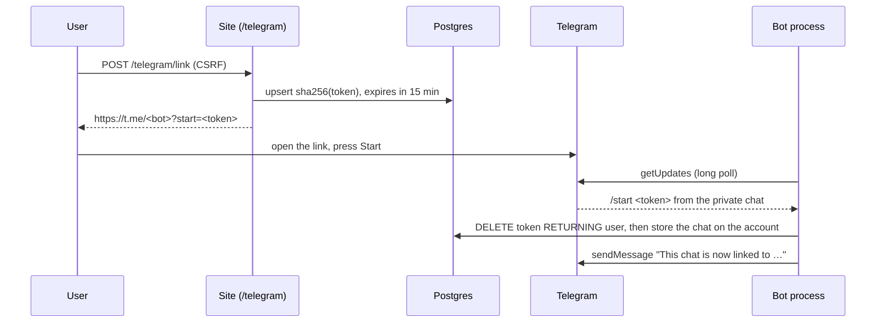

# Telegram

Matches are sent to a Telegram chat linked to the account. This page describes the bot, how a chat is linked, and how the bot token is kept secret. Sending matches comes with notifications, the last part of stage 7.

## Setting up a bot

1. Message [@BotFather](https://t.me/BotFather), send `/newbot`, and choose a name and a username ending in `bot`.
2. Put its token and username into `.env`. Never commit them: only `.env.example` is in the repository, with both empty.

   ```sh
   TELEGRAM_BOT_TOKEN=7000000001:AA...
   TELEGRAM_BOT_USERNAME=your_radar_bot
   PUBLIC_BASE_URL=http://localhost:8000
   ```

3. Start the stack with `docker compose up --build`. The `bot` service logs `telegram.polling` with the bot's username.

| Variable | Read by | Without it |
|---|---|---|
| `TELEGRAM_BOT_TOKEN` | the bot process; the worker, once it sends matches | the bot logs `telegram.not_configured` and exits with 0, and Compose leaves it stopped (`restart: on-failure`) |
| `TELEGRAM_BOT_USERNAME` | the web app, for the deep link; with or without `@` | `/telegram` says Telegram is not set up, and linking returns 503 |
| `PUBLIC_BASE_URL` | the bot, for links to the site in its replies | `http://localhost:8000` |

At start the bot calls `getMe`. A username that differs from `TELEGRAM_BOT_USERNAME` is logged as `telegram.username_mismatch`, because the site would then link people to another bot. The exit codes are chosen for Compose's `restart: on-failure`:

| Situation | Log | Exit | Compose |
|---|---|---|---|
| No `TELEGRAM_BOT_TOKEN` | `telegram.not_configured` (warning) | 0 | leaves it stopped |
| Telegram rejects the token (401), at start or while polling | `telegram.token_rejected` (error) | 0 | leaves it stopped: a restart would only repeat the rejected request. Fix the token and start it again |
| Start fails otherwise, such as no network yet | `telegram.start_failed` (error) | 1 | restarts it with a growing delay |
| `docker compose stop` | `telegram.stopped` | 0 | leaves it stopped |

## Linking a chat



- **The token** is 32 random bytes, 43 URL-safe characters, inside Telegram's limit of 64 characters from `[A-Za-z0-9_-]` for a deep-link parameter. Only its SHA-256 is stored in `telegram_link_token`, so a database dump holds no usable link. A plain hash is enough, since the token is random and long and cannot be guessed from it.
- **One use, 15 minutes.** `link_chat` deletes the token row and gets it back in one statement (`DELETE … RETURNING`). Of two `/start`s with the same token, only one gets the row. An expired token is deleted too and links nothing.
- **One token per account.** Asking for a new link replaces the previous token (`ON CONFLICT (user_id) DO UPDATE`).
- **One chat per account, one account per chat.** `app_user.telegram_chat_id` is unique and set together with `telegram_linked_at` (a CHECK). A chat linked to another account moves to the new one, because whoever sent the token controls both. Linking another chat replaces the account's old one.
- **The link is shown once**, in the response to the POST that issued it. It never appears in a GET URL, so it does not stay in the browser history. That page links to `GET /telegram` for the result instead of asking for a reload, because a reload would send the POST again and replace the token the user may be about to press Start with.
- **A chat that moves** from another account is told so in the bot's reply, without naming that account.
- **Unlinking** works from the site (`POST /telegram/unlink`) or by sending `/stop` to the bot. Deleting the account deletes its token (`ON DELETE CASCADE`), and the chat goes with the account row.

`telegram_linked_at` is when the chat was linked. `CurrentUserMiddleware` loads it with the account, so pages show it without a query of their own, always in UTC. Notifications will use it so that linking a chat does not send vacancies seen before.

**Accepted risk: a link sent to someone else.** Whoever presses Start on a deep link links their own chat to the account that issued it. Someone could send their link to another person, whose chat would then receive that account's matches. Nothing is gained by it: the sender gets nothing, and the bot's reply names the account's email, so the receiver sees it is not theirs and can send /stop.

## The bot

The bot process is `python -m vacancy_radar.telegram`, the `bot` service in Compose. Its `__main__` only starts it. The loop is in `telegram/polling.py`: it long-polls `getUpdates` and answers each message with `handle_update` (`telegram/bot.py`), a plain function a webhook could reuse. Long polling needs no public HTTPS endpoint, so the same process runs locally and on the VPS.

| Message | Reply |
|---|---|
| `/start <token>` | Links the chat and names the account's email, or says the link has expired or was used |
| `/stop` | Unlinks the chat |
| anything else, `/start` without a token included | A short help with a link to `/telegram` |

Commands sent as `/start@your_radar_bot` work too. Only private chats get replies: messages in groups and channels, and messages without text, are ignored. Every value inserted into a reply is HTML-escaped.

- **Offset.** The next update's offset is kept in memory. Polling with it confirms every earlier update, and Telegram keeps unconfirmed ones for 24 hours. When polling stops, one last `getUpdates` with the offset and no wait confirms the batch just answered. Without it, every restart or deploy would answer the last message again, and a `/start` would get "this link was already used" right after "linked". Only a killed process leaves its last batch unconfirmed.
- **A failing update** (a database error, a reply Telegram refuses) is logged as `telegram.update_failed` and confirmed anyway, so one bad message cannot stop the bot or crash it in a loop after every restart. The sender sees no reply and can press Start again.
- **A failing poll** (a timeout, a network error, a 5xx, a 409) is retried after a pause that doubles from 1 second up to 60. Telegram answers a second poller for the same bot with 409 Conflict, logged as `telegram.poll_conflict`. Only one bot process may run per token. A rejected token (401) is not retried and ends the process.
- **Timeouts.** `getUpdates` sets the read timeout of its own request to the poll's wait plus 10 seconds, so a quiet poll never times out, whatever the client's default. The Bot API has its own HTTP client (`build_http`, 10 seconds), separate from the source adapters' client, whose User-Agent and timeouts are agreed with the sources.
- **Stopping.** SIGTERM ends the current long poll (at most 20 seconds) and the process exits. Compose gives the service 30 seconds before it kills it.

## Keeping the token secret

The Bot API puts the token in every request URL (`https://api.telegram.org/bot<token>/sendMessage`). Two things keep it out of logs:

- httpx and httpcore log each request with its full URL at INFO. The Celery worker attaches a handler to the root logger at its own level, INFO, which would print them. `configure_logging` sets both loggers to WARNING (`log.py`). A test makes requests with root logging at DEBUG and checks that the token appears nowhere in the output.
- Errors from `TelegramClient` name the method only, never the URL. A timeout or network failure becomes `TelegramUnavailableError` with the httpx exception's class name, and the httpx exception is not chained (`from None`), because some httpx errors quote the URL.

## Errors

The client classifies every failure once, so callers decide by type, never by error code:

| Error | When | `retryable` |
|---|---|---|
| `TelegramUnavailableError` | no answer: a timeout or a network error | yes |
| `TelegramServerError` | 5xx, from Telegram or from a proxy in front of it, JSON or not | yes |
| `TelegramRateLimitedError` | 429; `retry_after` says how many seconds to wait (5 if Telegram ever leaves it out) | yes |
| `TelegramUnauthorizedError` | 401: the token is wrong or was revoked | no |
| `TelegramForbiddenError` | 403: the user blocked the bot | no |
| `TelegramConflictError` | 409: another process polls the same bot | no |
| `TelegramApiError` | any other `ok: false`, such as 400 "chat not found" | no |
| `TelegramMalformedError` | an answer not shaped like the Bot API, such as an HTML page with 200 | no |

All of them are `TelegramError`. The `Api` ones carry `error_code` and `description`. An update without an `update_id` is dropped from its batch rather than failing it; Telegram does not send such updates.

In settings the token is a `SecretStr`, hidden from `repr(settings)`. The tests never see a real token: `conftest.py` sets `TELEGRAM_BOT_TOKEN` empty and `TELEGRAM_BOT_USERNAME` to a made-up bot before a developer's `.env` could be read.

## Testing

The client is tested with respx against Bot API responses in `tests/fixtures/telegram/`. They are written by hand after the Bot API reference, because recording them needs a real bot and would put real chat ids into a public repository (`tests/fixtures/README.md`). Linking runs on the test Postgres, including the unique chat, the CHECK and the cascade.

To check linking for real, set up a bot as above, sign in at http://localhost:8000, open **Telegram**, press **Link Telegram**, then open the link and press Start. The page shows the chat as linked after a reload, and `SELECT email, telegram_chat_id, telegram_linked_at FROM app_user;` shows it in the database.
